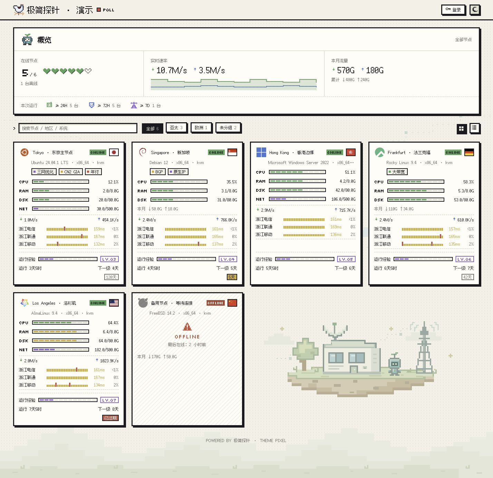
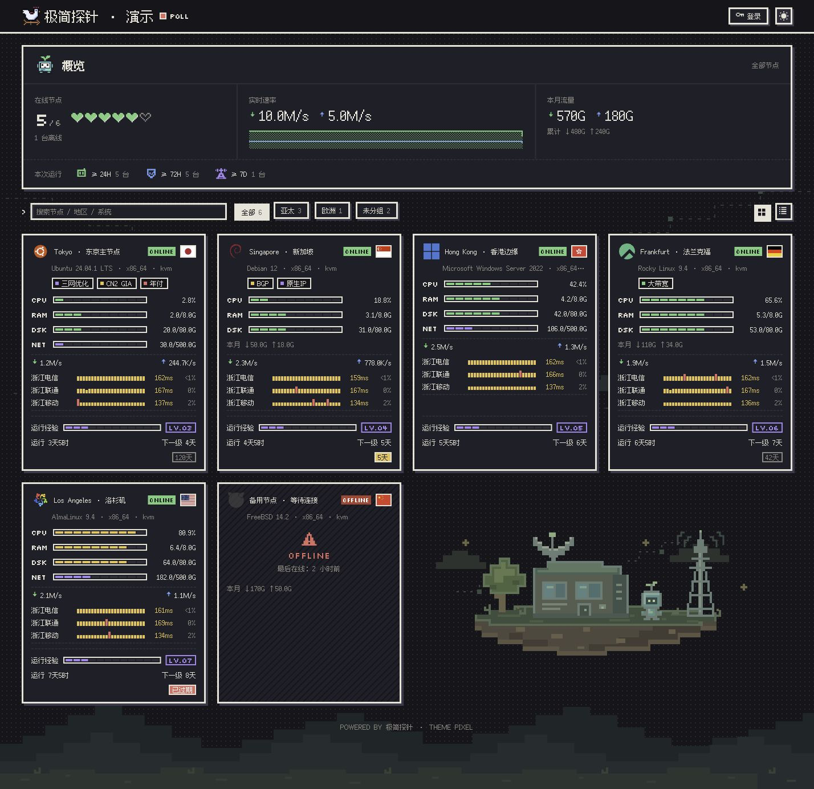

# Pixel for 极简探针





为 [极简探针 Monitor](https://github.com/monitor-probe/monitor) 制作的 8-bit 复古像素风主题：黑框硬阴影、方块进度条、阶梯折线图与像素字体，亮 / 暗两套配色。

## 功能

- **首页**：在线数、实时速率（带 2 分钟像素迷你图）、本月 / 累计流量与运行时长统计整合为概览；搜索框后提供分组筛选；卡片 / 列表两种布局；离线节点置底。
- **节点卡片**：右上角像素国旗；CPU / 内存 / 磁盘 / 流量配额方块条、实时上下行、在线时长、到期天数（使用 Hub 下发的 `expires_in`），可选显示价格。
- **备注标签**：节点的公开备注（Hub 1.3.2 起的 `public_remark`）按 `;` 或 `；` 拆分为多个标签，显示在卡片与详情页，所有访客可见；同名标签颜色固定。旧版 Hub 没有公开备注，退回读取只下发给已登录管理员的私有备注。
- **节点延迟**：卡片显示前几条探测线路的最新延迟、近 24 次采样的像素柱状条（绿 <100ms、黄 <200ms、红 ≥200ms 或超时）与 1 小时丢包率；列表视图增加 PING 列。
- **节点详情** `/node/{id}`：实时负载（CPU / 内存 / 交换 / 磁盘 / 流量配额 / 速率）、系统信息、历史图（CPU、内存与 Swap、网络、磁盘、TCP / UDP 连接数、进程数、多线路 Ping 与丢包），canvas 逐像素绘制，悬停显示读数。时间范围按 Hub 的保留天数生成（1H / 6H / 24H / 7D / 30D / 90D / 全部）；CPU 与网速另以淡色画出区间峰值。Swap、连接数与进程数需要 Hub 1.4.1+，旧版 Hub 不显示这几项。
- **实时数据**：优先使用 `/api/ws?gzip` 压缩推送（同时兼容文本帧），断开或 Hub 推送已满时退回 5 秒轮询，并以 5 秒起、最长 1 分钟的间隔重连。页面切到后台时断开推送、停止轮询；回到前台立即刷新并重连。
- **原创游戏元素**：像素守卫、在线节点爱心、运行经验条与 24H / 72H / 7D 成就；等级按本次系统运行的完整天数计算，每 24 小时升一级，重启后重新累计。成就只统计当前分组内在线且已上报指标的节点，不表示历史可用率。
- **像素世界背景**：淡色云朵、数据包线路与底部地形，宽屏节点网格的剩余空间展示原创机房浮岛；亮暗配色均适配，装饰不遮挡数据或响应点击。
- **站点 Logo**：内置风向鸡图标，默认跟随 Hub 后台设置；主题可单独配置顶栏 Logo 地址。
- **价格显示**：节点卡片与详情页共用显示开关，可进一步隐藏未登录访客的价格与付费周期。
- **字体**：Silkscreen（英文标题）+ 缝合像素字体 Fusion Pixel 12px（中文），均随主题包分发，不请求第三方服务。

## 1.3.3 更新内容

- 将顶部欢迎区与概览合并，移除“像素守卫”标题和欢迎语，运行时长统计收至概览底部；分组按钮移至搜索框后，手机端自动换行。
- 新增「对未登录访客隐藏价格与付费周期」，与「显示价格」联动，统一控制节点卡片和详情页；关闭「显示价格」时对所有人隐藏。
- 顶栏 Logo 默认跟随 Hub 后台的站点图标，并复用带缓存版本号的页签图标地址，刷新页面后同步生效。
- 新增主题「自定义 Logo 地址」以覆盖顶栏 Logo；加载失败时依次回退到 Hub 站点图标和内置图标。
- 默认 Logo、页签和主屏幕图标更换为风向鸡；更新亮色和暗色首页预览图。

## 1.3.2 更新内容：适配极简探针 1.4.1

- 节点详情的内存图加回 Swap 曲线，新增 CONNECTIONS（TCP / UDP）与 PROCESSES 历史图，数据来自 Hub 1.4.1 起 `/api/nodes/{id}/metrics` 的 `swap_used`、`tcp`、`udp`、`procs`；旧版 Hub 没有这些字段时不显示。
- 推送改连 `/api/ws?gzip`，接收 gzip 二进制帧，文本帧照常处理；浏览器不支持 `DecompressionStream` 时仍连文本推送。
- Hub 匿名推送满 1000 条回 503 时，页面靠轮询保持更新，重连间隔逐次加倍至 1 分钟，不再每 5 秒重试。
- 页面隐藏时断开推送、停止轮询并中止在途请求，回到前台立即拉取节点列表并重连；iOS 主屏幕 Web App 另以 `pageshow` / `focus` 兜底。详情页隐藏时也不再每分钟刷新历史图。连续失败 3 次才提示连接错误，避免刚恢复时网络未就绪而闪现报错。
- 离线时长改用 Hub 按自身时钟计算的 `last_seen_ago`（Hub 1.4.0+），访客电脑时钟不准时不再显示错误时长；旧版 Hub 仍按 `last_seen` 计算。
- 新增 180×180 不透明的 `/apple-touch-icon.png`，用于 iOS 书签与主屏幕；站长在 Hub 设置了站点图标时由 Hub 替换。
- 读写 `localStorage` 均已包裹 try/catch，浏览器禁用站点数据时不会白屏。

## 1.3.1 更新内容

- 修复「显示的延迟线路」留空时未沿用后台线路排序的问题，卡片和列表按后台顺序显示前几条线路；填写名称时仍按填写顺序显示。
- 节点详情的 Ping 曲线、图例与配色顺序同步沿用后台线路排序。
- 新增延迟线路排序回归验证，演示数据覆盖后台顺序与线路 ID 顺序不同的情况。

## 1.3.0 更新内容

- 新增原创像素守卫与在线节点爱心，站点图标同步改为守卫。
- 新增运行经验条、等级与 24H / 72H / 7D 成就，按本次系统启动后的运行时长统计，重启后重新累计。
- 新增像素云朵、数据包线路、底部地形与宽屏机房浮岛；修复暗色模式下背景插画仍使用亮色的问题。
- 更新亮色与暗色首页预览图。

## 适配极简探针 1.3.2

- 时间范围按 `/api/me` 的 `history_days` 生成，超过 7 天的窗口读 Hub 的小时汇总，并在范围按钮旁注明每点覆盖的时长；旧版 Hub 没有该字段时按 7 天。
- CPU 图画出 `cpu_max`，网速图画出 `net_rx_max` / `net_tx_max`（Hub 1.3.1+），以淡色显示在均值后方，悬停同时显示均值与峰值；Hub 不提供时不画。
- 备注标签改读公开备注 `public_remark`，普通访客也能看到。
- 价格按 Hub 的中文写法显示（如 `US$5.00 · 月付`、`NT$12.50 · 18 个月付`），支持任意三字母货币与 `<n>m` 付款周期；旧版 Hub 存下的非法货币代码不再导致报错。
- 跨多天的坐标轴只显示日期。

## 1.1.0 更新内容

- 卡片国家代码改为像素国旗（12×9 栅格化），无对应国旗时仍显示代码。
- 节点备注以标签形式展示，支持用分号分隔多个标签。
- 卡片中流量配额条移到磁盘下方；详情页新增同样的流量配额条，原速率行改名为 SPD。
- 站点图标与顶栏 Logo 换为像素小鸡。

## 站点设置

后台「主题」卡片中可修改，对所有访客生效：

| 设置 | 说明 |
| --- | --- |
| 默认配色 | 跟随系统 / 亮色 / 暗色；访客手动切换后以访客为准 |
| 默认布局 | 卡片或列表 |
| 自定义 Logo 地址 | 可选：覆盖顶栏 Logo，支持图片 URL 或站内路径，等比显示。留空时跟随 Hub 后台的站点图标（刷新页面后生效）；加载失败时依次回退到站点图标和默认风向鸡图标。浏览器页签图标仍使用 Hub 的站点图标设置 |
| 中文像素字体 | 关闭后中文使用系统字体，并不再加载约 600 KB 的字体文件 |
| 公告 | 首页顶部纯文本公告 |
| 显示概览 / 隐藏离线节点 | 首页显示开关 |
| 显示价格 | 控制节点卡片与详情页的价格和付费周期；关闭时对所有人隐藏 |
| 对未登录访客隐藏价格与付费周期 | 默认关闭；仅在「显示价格」开启时生效，开启后仅已登录用户可见。此选项控制主题展示，不改变 Hub API 返回的数据 |
| 显示延迟 | 每分钟为每个在线节点请求一次近 1 小时延迟记录（最多 4 个并发，标签页隐藏时暂停） |
| 卡片延迟线路数 | 未指定线路时，每张卡片与列表显示的前几条线路，1–6，默认 3 |
| 显示的延迟线路 | 线路名称，用逗号（`,` 或 `，`）隔开，按填写顺序显示，如 `浙江电信,浙江联通,浙江移动`；不区分大小写，节点没有的线路会跳过；留空则按后台线路排序显示前几条 |
| 默认时间范围 | 详情页历史图默认范围 |

## 安装

在极简探针后台「主题」→「上传主题包」，选择 [Releases](https://github.com/Gongsc/Theme-Pixel/releases) 中的 `theme.tar.gz` 并启用。Hub 1.3.2 起也可以直接填写仓库地址 `https://github.com/Gongsc/Theme-Pixel` 安装。

## 开发

需要 Node.js 22.12+：

```sh
npm ci
npm run dev       # 开发服务器，/api 代理到 127.0.0.1:9911
npm test          # 延迟线路排序与价格可见性回归验证
npm run build     # 类型检查并构建
npm run package   # 生成 release/theme.tar.gz
```

设置 `MONITOR_HUB=https://hub.example.com` 可代理到已开启公开状态页的现成 Hub。没有 Hub 时运行 `python3 scripts/demo-server.py` 提供按 Hub 1.3.2 行为模拟的演示数据（`PORT=9922` 可换端口，同时设置 `MONITOR_HUB=http://127.0.0.1:9922`）。

发布新版本：把 `theme.json`、`package.json`、`package-lock.json` 中的版本号改为同一版本，推送 `x.y.z` 格式的 tag，GitHub Actions 会构建并创建带 `theme.tar.gz` 的 Release。

## 许可

MIT。Silkscreen 与 Fusion Pixel 字体均使用 SIL Open Font License 1.1；国旗来自 [flag-icons](https://github.com/lipis/flag-icons)（MIT）。默认站点 Logo 使用站长提供的风向鸡图片；像素守卫、成就与背景插画为项目内原创 SVG。
