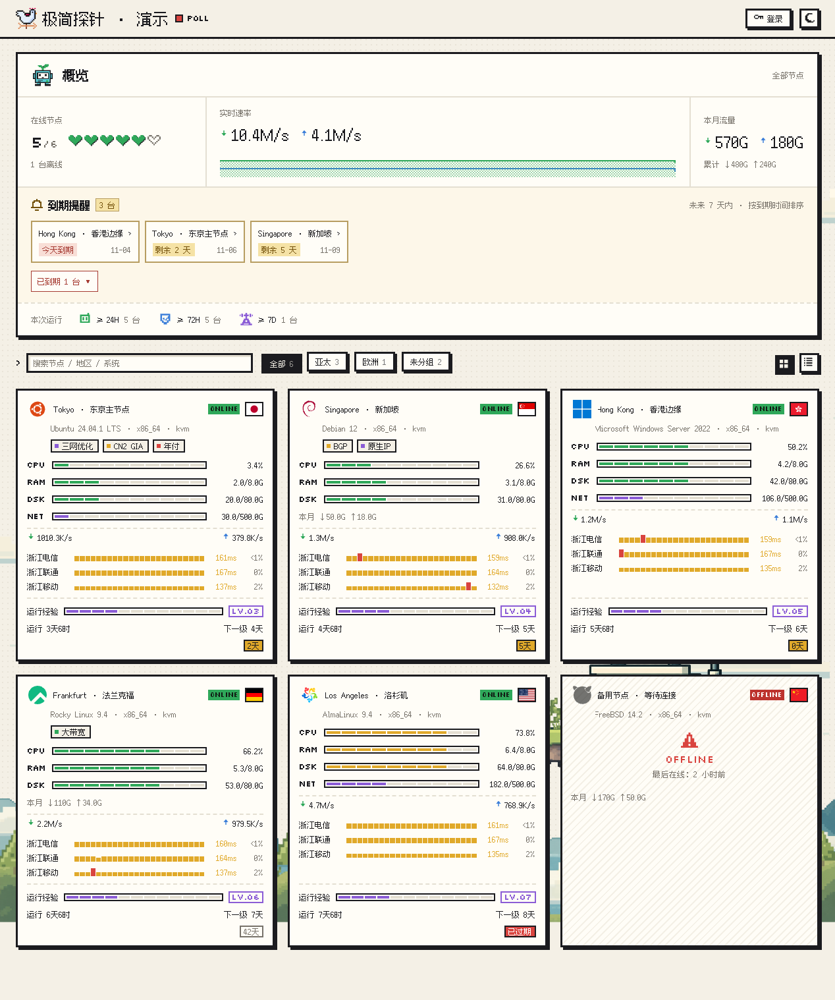
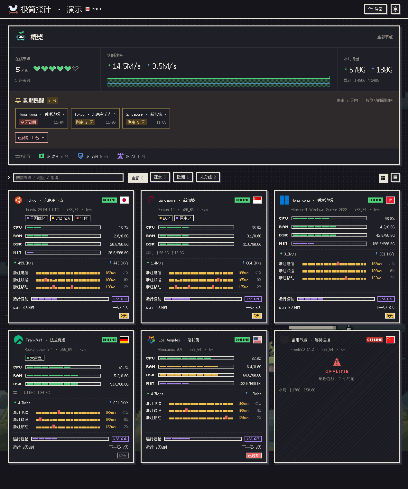

# Pixel for 极简探针





为 [极简探针 Monitor](https://github.com/monitor-probe/monitor) 制作的 8-bit 复古像素风主题：黑框硬阴影、方块进度条、阶梯折线图与像素字体，亮 / 暗两套配色。

## 功能

- **首页**：在线数、实时速率（带 2 分钟像素迷你图）、本月 / 累计流量与运行时长统计整合为概览；三项统计按内容分配宽度、垂直居中；搜索框后提供分组筛选；卡片 / 列表两种布局；离线节点置底。
- **到期提醒**：概览中按到期先后展示未来指定天数内的节点（默认 7 天），包含今天到期；提醒卡片按内容宽度排列、自动换行，减少留白。默认显示最近 3 台，可展开全部，已到期节点单独折叠显示。跟随当前分组与隐藏离线设置；关闭提醒或没有符合条件的节点时，整个提醒区域隐藏。
- **节点卡片**：左上角按操作系统名称匹配像素 Logo（覆盖 21 种系统图标，无法识别时显示通用服务器图标，离线时变灰），右上角 24×18 像素国旗；CPU / 内存 / 磁盘 / 流量配额方块条、实时上下行、在线时长、到期天数（使用 Hub 下发的 `expires_in`），可选显示价格。
- **备注标签**：公开备注（Hub 1.3.2 起的 `public_remark`）对所有访客可见；私有备注（`remark`）仅登录管理员后显示，与公开备注同时呈现，并使用虚线边框区分，悬停可查看备注类型。卡片、列表和详情页均支持；按 `;`、`；` 或换行拆分，同一范围内去重，同名标签颜色固定。私有备注只读取 Hub 向管理员下发的字段。
- **节点延迟**：卡片显示前几条探测线路的最新延迟、近 24 次采样的像素柱状条（绿 <100ms、黄 <200ms、红 ≥200ms 或超时）与 1 小时丢包率；列表视图增加 PING 列。
- **节点详情** `/node/{id}`：实时负载（CPU / 内存 / 交换 / 磁盘 / 流量配额 / 速率）、系统信息、历史图（CPU、内存与 Swap、网络、磁盘、TCP / UDP 连接数、进程数、多线路 Ping 与丢包），canvas 逐像素绘制，悬停显示读数。时间范围按 Hub 的保留天数生成（1H / 6H / 24H / 7D / 30D / 90D / 全部）；CPU 与网速另以淡色画出区间峰值。Swap、连接数与进程数需要 Hub 1.4.1+，旧版 Hub 不显示这几项。
- **线路历史图**：PING 图例单击显示或隐藏线路，双击只看该线路，ALL 恢复全部；丢包率曲线与 PING 共用时间范围和线路筛选，纵轴固定为 0–100%。缺失的采样值保留为空缺，没有丢包率历史数据时显示提示。
- **实时数据**：优先使用 `/api/ws?gzip` 压缩推送（同时兼容文本帧），断开或 Hub 推送已满时退回 5 秒轮询，并以 5 秒起、最长 1 分钟的间隔重连。页面切到后台时断开推送、停止轮询；回到前台立即刷新并重连。
- **原创游戏元素**：像素守卫、在线节点爱心、运行经验条与 24H / 72H / 7D 成就；等级按本次系统运行的完整天数计算，每 24 小时升一级，重启后重新累计。爱心按可用宽度最多排列三行，放不下的节点以“+数量”显示；运行成就的悬停提示立即显示，也支持键盘聚焦。成就只统计当前分组内在线且已上报指标的节点，不表示历史可用率。
- **像素世界背景**：固定在浏览器视口的云端机房浮岛、远景小岛与分层山景，云层分速缓移、植物与垂藤错相摆动、数据光点沿线路移动、天线与状态灯循环闪烁；随窗口宽度缩放，手机端简化构图，亮暗配色均适配。装饰不遮挡数据或响应点击，系统开启「减少动态效果」时暂停动画。插画以透明 WebP 随主题分发，无外部图片请求。
- **站点 Logo**：内置风向鸡图标，默认跟随 Hub 后台设置；主题可单独配置顶栏 Logo 地址。
- **价格显示**：节点卡片与详情页共用显示开关，可进一步隐藏未登录访客的价格与付费周期。
- **字体**：Silkscreen（英文标题）+ 缝合像素字体 Fusion Pixel 12px（中文），均随主题包分发，不请求第三方服务。

版本更新记录请查看 [GitHub Releases](https://github.com/Gongsc/Theme-Pixel/releases)。

## 站点设置

后台「主题」卡片中可修改，对所有访客生效：

| 设置 | 说明 |
| --- | --- |
| 默认配色 | 跟随系统 / 亮色 / 暗色；访客手动切换后以访客为准 |
| 默认布局 | 卡片或列表 |
| 背景动态效果 | 默认开启；关闭后背景保留、动画停止。系统开启「减少动态效果」时优先显示静态背景 |
| 自定义 Logo 地址 | 可选：覆盖顶栏 Logo，支持图片 URL 或站内路径，等比显示。留空时跟随 Hub 后台的站点图标（刷新页面后生效）；加载失败时依次回退到站点图标和默认风向鸡图标。浏览器页签图标仍使用 Hub 的站点图标设置 |
| 中文像素字体 | 关闭后中文使用系统字体，并不再加载约 600 KB 的字体文件 |
| 公告 | 首页顶部纯文本公告 |
| 显示概览 / 隐藏离线节点 | 首页显示开关 |
| 到期提醒天数 | 默认 7 天，支持 0–365 天（小数向下取整）；设为 0 关闭。未设置到期日期的节点不参与提醒，当前分组无符合条件的节点时不显示提醒区域 |
| 显示价格 | 控制节点卡片与详情页的价格和付费周期；关闭时对所有人隐藏 |
| 对未登录访客隐藏价格与付费周期 | 默认关闭；仅在「显示价格」开启时生效，开启后仅已登录用户可见。此选项控制主题展示，不改变 Hub API 返回的数据 |
| 显示延迟 | 每分钟为每个在线节点请求一次近 1 小时延迟记录（最多 4 个并发，标签页隐藏时暂停） |
| 卡片延迟线路数 | 未指定线路时，每张卡片与列表显示的前几条线路，1–6，默认 3 |
| 显示的延迟线路 | 线路名称，用逗号（`,` 或 `，`）隔开，按填写顺序显示，如 `浙江电信,浙江联通,浙江移动`；不区分大小写，节点没有的线路会跳过；留空则按后台线路排序显示前几条 |
| 默认时间范围 | 详情页历史图默认范围 |

## 配置导入与导出

登录管理员账号后，在 Pixel 公开页面的顶栏点击「主题配置」。

- **导出当前配置**：下载当前服务器上 Pixel 的完整配置（含默认值）为 JSON。
- **导入配置文件**：选择备份 JSON，也可展开「粘贴配置 JSON」直接粘贴；预览变更后点击「保存导入配置」，再刷新页面生效。点击取消不会改动已保存的配置。
- 仅接受同一主题的备份；缺失字段使用当前版本默认值，未知字段忽略，字段类型、范围或选项无效时拒绝整个文件。导入文件上限 256 KiB，保存配置上限 64 KiB。

此功能随主题包提供，使用 Hub 现有主题配置接口，无需修改极简探针。未登录访客不显示入口，保存仍由 Hub 校验管理员权限；配置内容与后台「主题设置」共用。

## 安装

在极简探针后台「主题」→「上传主题包」，选择 [Releases](https://github.com/Gongsc/Theme-Pixel/releases) 中的 `theme.tar.gz` 并启用。Hub 1.3.2 起也可以直接填写仓库地址 `https://github.com/Gongsc/Theme-Pixel` 安装。

## 开发

需要 Node.js 22.12+：

```sh
npm ci
npm run dev       # 开发服务器，/api 代理到 127.0.0.1:9911
npm test          # 延迟排序、价格可见性、配置导入导出与系统图标匹配验证
npm run build     # 类型检查并构建
npm run package   # 生成 release/theme.tar.gz
```

设置 `MONITOR_HUB=https://hub.example.com` 可代理到已开启公开状态页的现成 Hub。没有 Hub 时运行 `python3 scripts/demo-server.py` 提供按 Hub 1.3.2 行为模拟的演示数据（`PORT=9922` 可换端口，同时设置 `MONITOR_HUB=http://127.0.0.1:9922`）。

更新说明统一维护在对应的 GitHub Release 中，README 仅保留当前功能与使用说明。

发布新版本：把 `theme.json`、`package.json`、`package-lock.json` 中的版本号改为同一版本，推送 `x.y.z` 格式的 tag，GitHub Actions 会构建并创建带 `theme.tar.gz` 的 Release。

## 许可

MIT。Silkscreen 与 Fusion Pixel 字体均使用 SIL Open Font License 1.1；国旗来自 [flag-icons](https://github.com/lipis/flag-icons)（MIT）。操作系统 Logo 主要提取自 [komari-theme-Glassmorphism](https://github.com/sanrokamlan-prog/komari-theme-Glassmorphism)，Proxmox 图标来自 [Devicon](https://github.com/devicons/devicon)（均为 MIT）；在卡片内以透明底 28×28 像素栅格显示，许可证随主题包分发；默认站点 Logo 使用站长提供的风向鸡图片；像素守卫、成就与背景动画层为项目内原创 SVG；浮岛与山谷底图由 ImageGen 生成并以透明 WebP 分发，制作记录见 [背景资源说明](src/assets/world/README.md)。
